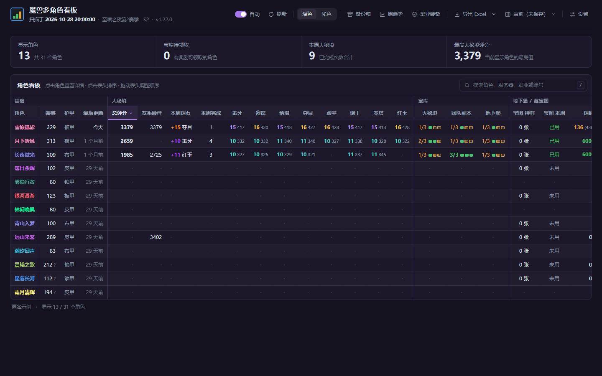
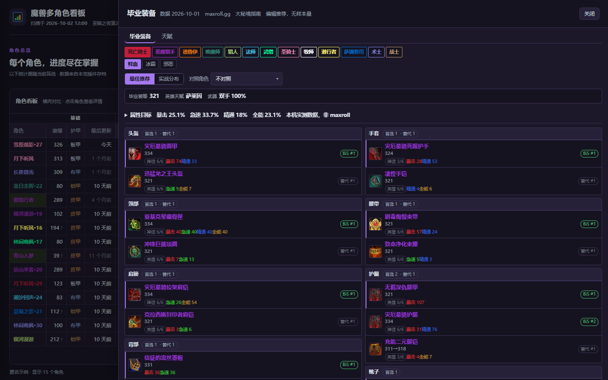

# WoW Alt Board (WowAltBoard)

[简体中文](../README.md) | **English**

[](../LICENSE)
[](https://ifdian.net/a/lianzy)

Turns the data saved by an in-game addon into a local web page: mythic+,
the Great Vault, delves, treasure maps, raids, crests, prey, gear, gold and
professions for **every character on every Battle.net account**, side by side in
one table. Screenshots use anonymized sample data.



## Download and install

**[Download the latest ZIP from Releases](https://github.com/Lianzy-Baimiao/WowAltBoard/releases/latest)**

Download the `WowAltBoard-vX.Y.Z.zip` asset (**not** the "Source code" archive),
extract it into a **writable** folder, and double-click `魔兽看板.exe` (the
launcher). That is all.

Windows 10/11 uses the built-in PowerShell and .NET. New versions prefer the
native WebView2 window and fall back to a Chrome / Edge app window when the
WebView2 Runtime is missing. To get a desktop icon, use "Create desktop
shortcut" in the tray menu.

## Application updates

Since **v1.18.0**, **Settings → Other → Application updates** can check for and
download new versions. It updates the whole board (launcher, UI, scanner and the
data/icons shipped with each version), not just best-gear data. Downloads are
per component; you confirm the restart, and character data, settings and game
paths are preserved. The previous application files can be restored. Optional
automatic checks and background downloads are off by default and never force a
restart.

**v1.17.3 and older must be upgraded manually once to v1.18.0 or newer.** Exit
the old version, back up the folder, extract the full package and overwrite the
application files; keep the existing `data/` and `tools/config.json` instead of
overwriting them with the empty config from the package. After that, use the
built-in updater and there is no need to download the `update-*.zip` component
packages by hand. Maintainers must upload the manifest and component packages
with each Release; see [application updates and release notes](application-updates.en.md).

## Quick start

1. Install and enable the [AlterEgo](https://www.curseforge.com/wow/addons/alterego) addon (required data source)
2. Log in to each character you want to see, then `/reload` or exit the game so the addon writes its save
3. Double-click `魔兽看板.exe`: it scans the WoW folder, opens the board window and stays in the tray, rescanning whenever the game writes
4. For a **professions** column, also install [BagSync](https://www.curseforge.com/wow/addons/bagsync); the **backup box** needs MySlot or the edit-mode cache. Both are optional; without them you just lose a few columns

Tray context menu: Open board / Rescan now / **Set game folder** / Create desktop
shortcut / Exit. Only retail is read by default; to include Classic realms,
edit `includeFlavors` in `tools/config.json`.

## Features

* **Every character in one table**: multiple accounts and realms, 60+ columns on demand, click a header to sort, drag headers to reorder columns (whole groups move too); save a tuned view as a named "layout" and switch back to it in one click
* **Character details**: click any row for per-dungeon best runs, the three vault slots, 16 gear slots and the prey checklist
* **Weekly trends**: compare score, item level, vault and treasure-map progress by game week
* **Best gear / talents** ("Best gear" in the top bar): recommended best-in-slot gear for all 40 specs, comparison with your own character, stat targets and popular talent strings from leaderboards — all bundled and available offline
* **Export**: Excel / CSV / print to PDF; the export matches exactly the columns and rows on screen
* **Runs locally**: copy the whole folder to a USB drive or another PC and it still works; reference data is readable offline; the optional updater only contacts the official release source



In the talent panel, click "Copy" to get the official import string, then press
`N` in game → "Import/Export" at the lower right → "Import" and paste it.

## Bilingual interface

The board ships in Simplified Chinese and English. It **follows the system
language by default**: a Chinese system shows Chinese, anything else shows
English. Change it under **Settings → Appearance → Interface language** (Auto /
简体中文 / English). The launcher tray menu, dialogs and native window follow the
system language too; they can be overridden with `--lang=en` / `--lang=zh` or
`"uiLang": "en"` in `tools/config.json`. Game data (character names, items,
dungeons, talent names) follows the game client language and is not translated
separately.

## FAQ

**The game folder is not found** Use "Set game folder" in the tray menu, or edit
`wowPaths` in `tools/config.json` (double every backslash).

**No data is scanned** The board shows a dialog with the exact reason (addon not
installed / installed but disabled / never logged in). The usual fix: install
AlterEgo, log in, `/reload`, then click "Rescan".

**Data is stale after a `/reload`** The board reads the save the addon writes to
disk, never game memory. 1.17.1 fixed open boards not refreshing, an incorrect
file-watcher callback thread, and missed retries after a failed scan. New
versions check for scan results every 5 seconds by default and refresh only when
there is something new; they also check when the board regains focus. Keep the
launcher running: after `/reload`, expect 5–10 seconds, or about 25 seconds plus
scan time when the polling fallback is needed. Refresh is deferred while a
details/settings panel is open or while you are typing; close the panel or leave
the input and wait one more cycle. Since 1.17.2 the native window's **Refresh**
button performs a manual scan: one click scans and refreshes on success, is
disabled while scanning, and keeps the current page with an explanation on
failure. Manual scan still works even with automatic refresh off. F5 only
reloads the page and does not scan; a normal browser window cannot start a local
scan, so the button points to the desktop app or the tray's "Rescan now" and
offers "reload already-scanned data only". If a manual scan still shows old data,
check whether the account's `SavedVariables/AlterEgo.lua` modification time
changed after the `/reload`. On 1.17.0, manual rescan + refresh is a temporary
workaround; you do not have to exit the game first.

**The version shown in settings is behind** Since 1.17.3 the panel clearly shows
the version "last found by a check" and the time of the scan record, instead of
labeling an old record as "latest". "View latest version" always opens the
GitHub latest release page, never a fixed link to an old version. Use **Settings
→ Other → Application updates** in new versions; with the native window open,
the tray's "Check for updates" also opens the new updater. Old scan records are
kept only in the compatibility details.

**Window size and position** The native window saves its position, size and
maximized state when dragging/resizing ends and when it closes, and restores
them next time; exiting while minimized does not leave it minimized next launch.
The record lives in `data/desktop-window.json`, and the first run tries to adopt
the old `data/window.txt`. If a monitor is removed or the work area changes, the
window is moved back into view.

**Antivirus quarantined the exe** The exe is compiled at release time and some
scanners flag it. Use `启动.bat` instead; it has the same functionality (and
opens a console window).

**Reading Classic realms** Set `includeFlavors` in `tools/config.json` to `[]`
(read everything) or list the flavors you want.

**How best-gear / talent data is updated** Regular users receive the data the
maintainer ships with each version through "Application updates"; no Node.js and
no upstream credentials are required. Every reference dataset still shows its
own date; an app update does not mean upstream data is necessarily the newest.
An advanced temporary option is "Data sources and updates → reload remote copy
(this session only)": it applies only to the current session and writes nothing
to disk. `更新数据.bat` and its fetch commands are maintainer tools; automatic
guide scraping is disabled and source restrictions are not bypassed.

## Data and privacy

* All data is read from local addon saves (`WTF/Account/.../SavedVariables`) and
  the parsed result is written into the board's `data/` folder — that is your
  character names, realms, guild, gold, account folder names and absolute paths.
  **Do not upload or share `data/`**
* The page and character scanning run locally. Manually checking/downloading
  application updates contacts the official GitHub Release; automatic checks and
  background downloads are off by default and can be enabled under "Application
  updates". The old compatibility check still uses `checkForUpdates` in the config
* Clicking "reload remote copy" or a source link accesses the corresponding
  network address; these actions never upload local character data
* Backup strings (MySlot etc.) are stored locally only and are never sent anywhere

## Known limitations

* Only characters that **have AlterEgo installed and have logged in** are visible
* The professions column depends on BagSync; without it the column is absent
* The main table's currencies have no icons (the save only contains internal game IDs); best-gear icons are bundled
* Prey boss names are English (the game does not write Chinese names into the save)
* The talent tree is a read-only viewer, not a simulator; edit talents with the import string the panel provides

## Development

```
node tools\run-tests.js        # offline test suite; or open tests.html
tools\build-launcher.ps1       # compile the launcher exe
tools\build-release.ps1        # build the release ZIP
```

The repository does not contain `data/` (personal data, gitignored) or the exes
(distributed as Release assets). The fetch scripts for reference data between
seasons live in `tools/` (`gen-bis.js`, `gen-talents.js`, `fetch-*.js`, and need
network access).

Author: 白描 ([GitHub](https://github.com/Lianzy-Baimiao))　License: MIT

## Donate

The tool is free with no ads and no microtransactions. If it saves you time
every week across alts, buy me a coffee:
**<https://ifdian.net/a/lianzy>** (also in the board: Settings → Donate)

## Desktop window and release package

The launcher prefers the **native WebView2 desktop window** and no longer uses a
browser app window as the only shell.

- Windows 11: title bar, frame and caption follow the board's light/dark theme and skin, while system drag, resize, snap, minimize and maximize are preserved.
- Windows 10: uses the native system window; supported versions also tint the title bar. The exact title-bar color depends on system capabilities and is not guaranteed to match Windows 11.
- Without the WebView2 Evergreen Runtime, or when the desktop components are incomplete, the launcher falls back to a Chrome / Edge app window. It never installs a runtime silently.
- External web links open in the default browser, never inside the board window.
- The desktop window's own browser cache lives in `data/webview2/`; the last window colors live in `data/desktop-theme.json`. Both are personal data and are excluded from the release ZIP.

**Before switching for the first time**: the native window and a normal browser
do not share localStorage. To carry over layouts that were not yet written to
disk, first save settings to a file under "Settings" in the old board, let the
launcher scan and absorb them into `data/settings.js`, then switch. Unneeded
cache can be cleaned after fully exiting the program.

Releases remain green ZIPs with no installer. The entry point after extraction is
still `魔兽看板.exe`; the native window and its few dependencies live in
`tools/desktop/` and should not be moved individually.

Building:

```powershell
# Compile the launcher and the native window. The first build downloads the
# pinned WebView2 SDK from NuGet.
.\tools\build-launcher.ps1

# Build a separate preview package without overwriting the official ZIP of the
# same version.
.\tools\build-release.ps1 -Suffix desktop-preview
```

The SDK is pinned to `Microsoft.Web.WebView2 1.0.2903.40` and cached under
`%LOCALAPPDATA%\WowAltBoard-build\`. The release only contains the managed
bridge DLLs, the per-architecture loader and the license files, not the whole
browser. Running the app needs no NuGet, Node.js or development SDK. ARM64
devices can run it through the system's x64/x86 emulation; it has not been
verified on ARM64 hardware.
